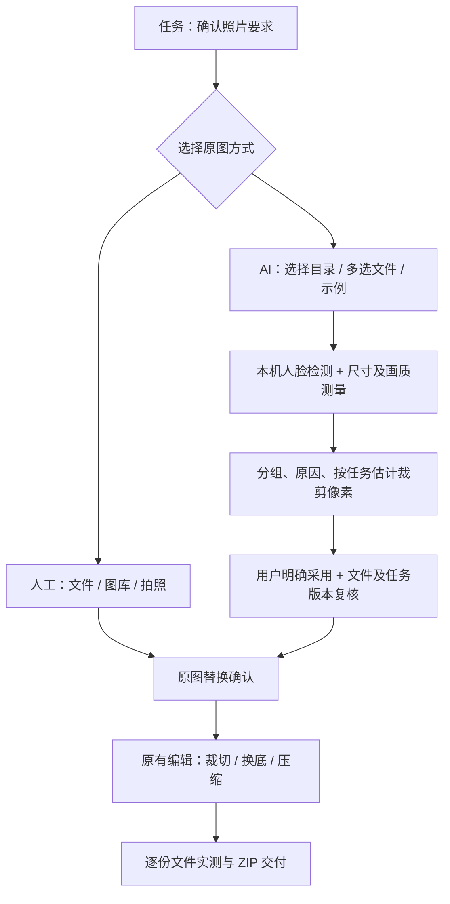

# 按任务要求在本机找照片

本功能在现有制作、OCR 要求导入和交付流程上增加候选照片寻找；人工 Files / Photos / 拍照始终保留。当前为开发分支能力，发布与验收状态见 [发布记录](release/next-photo-finder/verification.md)。

## 用户流程

1. 首页「AI 找照片」选择或创建任务，添加至少一份像素要求；也可从任务的原图卡进入。
2. 选择本地目录或明确多选文件。子目录默认不扫描，需单独勾选。
3. 本机读取尺寸、检测人脸与姿态，按任务裁剪像素覆盖和参考画质排序；可以停止、分组、搜索文件名/相对路径。
4. 查看理由、预览和逐项裁剪估计，点击「采用此照片」。原有照片须确认替换；再进入原有编辑器调整、换底、压缩和逐份交付。
5. 随时返回人工选图。推荐不是资格判定，不阻止用户采用低像素或无法检测到人脸但能正常解码的照片。

## 模型与计算边界

| 操作 | iOS | Android |
|---|---|---|
| 目录与文件授权 | UIDocumentPicker + security-scoped URL + NSFileCoordinator | SAF：ACTION_OPEN_DOCUMENT_TREE / ACTION_OPEN_DOCUMENT，content URI |
| 人脸检测与可用姿态角 | Apple Vision，系统内置 | 随包 ML Kit Face Detection 16.1.7 |
| 显示方向与解码 | ImageIO，应用 EXIF | BitmapFactory + ExifInterface，应用 EXIF |
| 尺寸、裁剪像素覆盖 | 本地确定性计算 | 本地确定性计算 |
| 清晰度、曝光参考 | 最长边 1280 缩略图中单人脸区域的拉普拉斯方差与平均亮度 | 同左 |

本功能不需要新增远程模型下载，国内外均可使用随系统/安装包提供的检测能力。Android ML Kit 的技术诊断披露仍适用，不宣称整个应用零网络。无身份识别、年龄/性别/族裔推断、身份聚类或人脸向量库。

已评估 [EmbeddingGemma 2](https://blog.google/innovation-and-ai/technology/developers-tools/embeddinggemma-2/)：它是多模态嵌入模型，适合未来语义检索，并非尺寸、人数和裁剪像素的直接判断器。本版不引入约 1.49 GB 原始权重。国际 [Hugging Face](https://huggingface.co/google/embeddinggemma-2) 与国内 [ModelScope](https://modelscope.cn/models/google/embeddinggemma-2) 的文件元数据报告相同尺寸和 SHA，尚未完成两地完整下载、量化和手机推理验收，不能宣传已支持。研究证据见[设计](superpowers/specs/2026-11-09-ai-photo-finder-design.md)。

## 分组与解释

- **优先查看**：检测到单人，姿态可估计且在参考范围，裁剪像素满足所有任务，画质参考未触发提示，估计裁剪不会切到检测到的人脸框。
- **人工判断**：多人、姿态缺失/偏转、小脸、模糊/曝光或测量未知等。不会把未知值当作合格。
- **裁剪像素不足**：逐项说明保守裁剪后的像素估计。源文件 KB 不用于淘汰，最终 KB 由原有压缩流程处理。
- **未知/跳过**：未检测到脸仍可采用；不支持、损坏、超限、未下载或无法证明本地状态的文件明确跳过。

当前参考阈值：偏航绝对值大于 15°、翻滚大于 12°，人脸短边少于 160 原始像素，脸部亮度小于 45 或大于 220、拉普拉斯方差低于 45 时提示复核。它们是工程启发式，并非机构验证或人群校准的阈值。公开示例只覆盖基础路径，不能证明真实人群准确率。无概率或“AI 合规分”。排序先看覆盖的要求数，再看单人和参考理由；跨系统检测结果可能不同。

裁剪框使用人脸框高度约两倍、任务宽高比和边界钳制，属于估计；不是发顶、完整头部或正式构图检测。预览最多 1280 像素，可放大查看，原图只在明确采用时复制。编辑器最终构图与成片文件实测为准。

## 限制与隐私

单次最多 2000 个目录项、500 张照片、5 层；每张 30 MB、2400 万像素；顺序分析。支持 JPEG、PNG 和原生可解码 HEIC；GIF/WebP 等明确跳过。缩略图缓存最多 100 MB，触顶结束为部分扫描。两端层级均包含根下第 1–5 层。

Android 11+ 无法选 Downloads 根目录，应选子文件夹或多选文件。不申请 MANAGE_EXTERNAL_STORAGE、整库读取、不持久化 SAF 权限或 iOS bookmark。Android 目录仅接受已知本地 provider；iOS 跳过未下载 iCloud 项及无法证明本地状态的 provider。显式多选文件的提供方仍可能下载所选文件，页面有说明。

停止保留已完成结果供选择；切换来源、清除或离开页面结束访问并删除原生缓存。退后台停止继续扫描，单次在途计算可结束但旧返回被忽略。异常残留在下一次初始化时按 24 小时 TTL 清理，系统也可能更早清除缓存。公共示例衍生图是应用演示素材，并非私人照片。

采用前重新读原文件并校验 SHA-256；任务原图版本或任一要求改变后拒绝旧结果。只保存采用的照片到任务，受影响成片失效；不修改、移动或删除外部原图。ZIP 不包含扫描目录、未选照片或人脸特征。

## 工程接口

`photoid/photo_finder`：chooseDirectory(recursive)、chooseFiles、openDemo(paths，仅应用私有路径)、analyze(session,id)、materialize(session,id,fingerprint)、interrupt(session)、close(session)。会话和文件使用不可猜测 UUID，UI 只显示相对路径。Dart 的 scope/scan token 拒绝迟到结果，存储事务中的 expectedSelectionToken 拒绝过期采用。

关键文件：`photo_finder_models.dart`、`photo_finder_ranking.dart`、`photo_finder_session.dart`、`photo_finder_demo.dart`、`photo_finder_page.dart`，以及 iOS/Android `PhotoFinderBridge`。原有手动选图仍使用 `choosePhotoInput`。
