# 工程界面采集，不是最终 App Store 素材

2026-11-09，Android 模拟器 `imagepilot_caption_test` / emulator-5554。生产 PhotoFinderPage、生产主题与本地化，临时示例任务，实际随包 ML Kit 检测；Wi-Fi 和移动数据关闭。Flutter integration_test 原生截图，经人工查看确认包含实际页面，并有 setup/results 字节不同的回归断言。文件 SHA-256 见 android/manifest.json。

| 设置 EN | 候选 EN | 裁剪 EN |
|---|---|---|
| 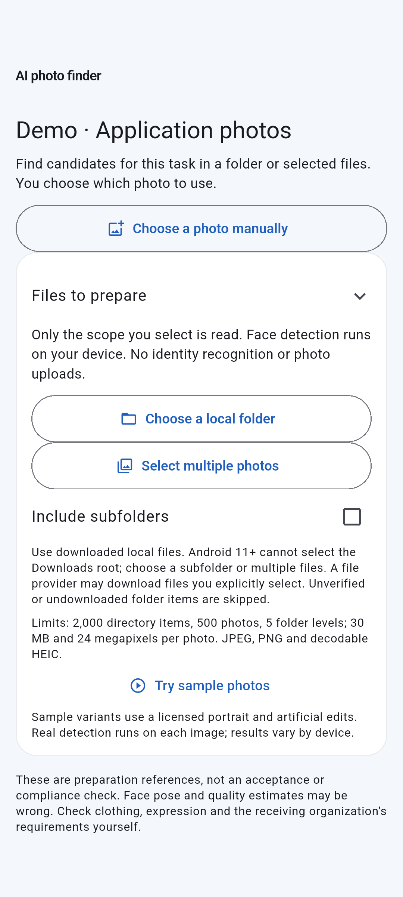 | 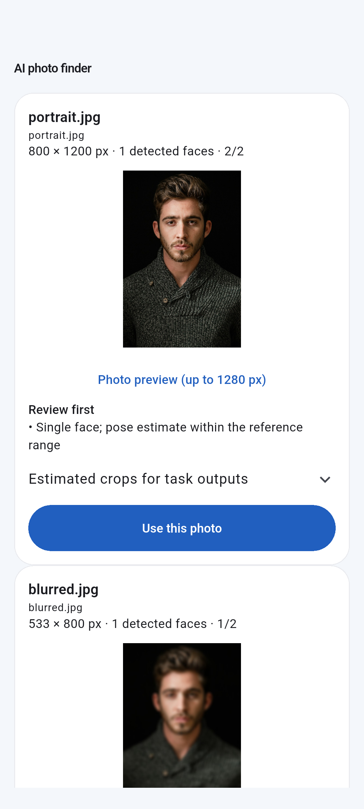 | 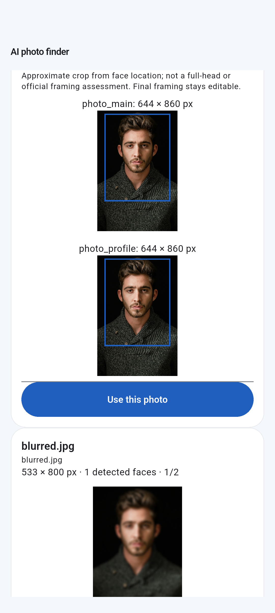 |

| 设置中文 | 候选中文 | 裁剪中文 |
|---|---|---|
| 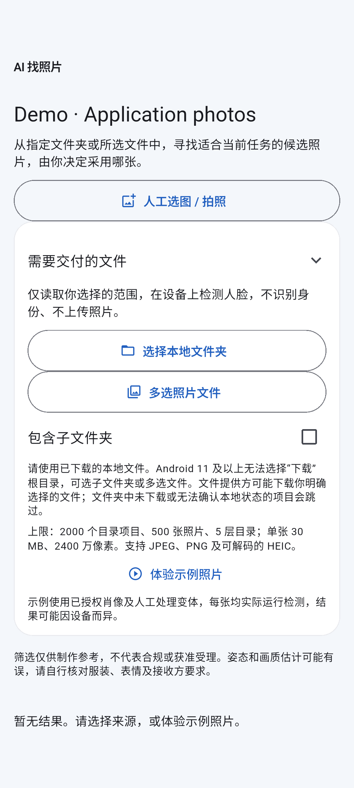 | 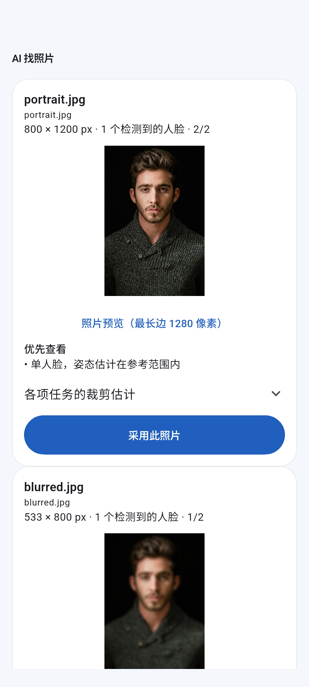 | 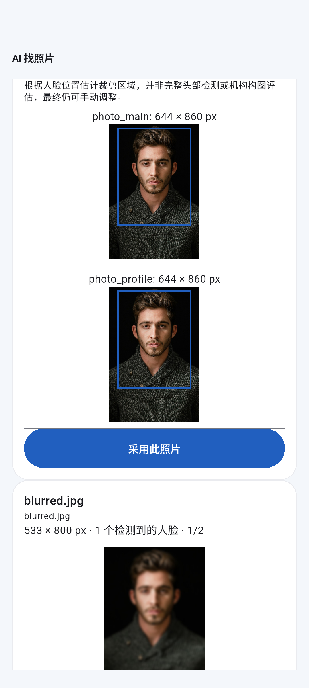 |

这些是 Android 工程测试设备采集，不能标作 iPhone/iPad 的 Store 截图。任务名为英文演示任务；中文界面切换不改写任务名称。

iPhone 13（iOS 27.0.1，1170×2532）的首轮缓存启动画面已剔除。后续原生集成测试全部通过、setup/results 图像变化断言通过，并人工查看了真实页面。有效中英文设置/候选/裁剪图如下；同样是生产页面的工程测试宿主采集（没有完整应用导航上下文），不是完整应用的最终 Store 素材。

| iPhone 中文设置 | iPhone 中文候选 | iPhone 中文裁剪 |
|---|---|---|
| 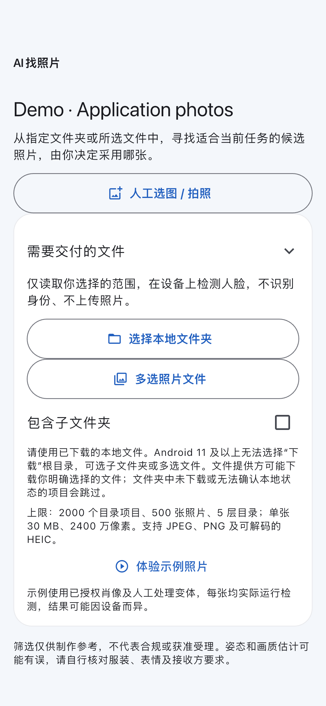 | 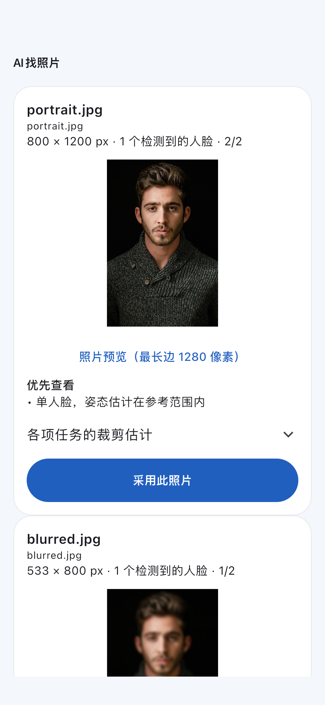 | 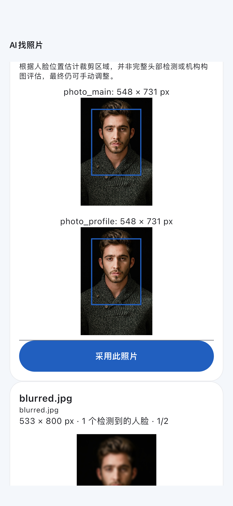 |

| iPhone EN setup | iPhone EN results | iPhone EN crops |
|---|---|---|
| 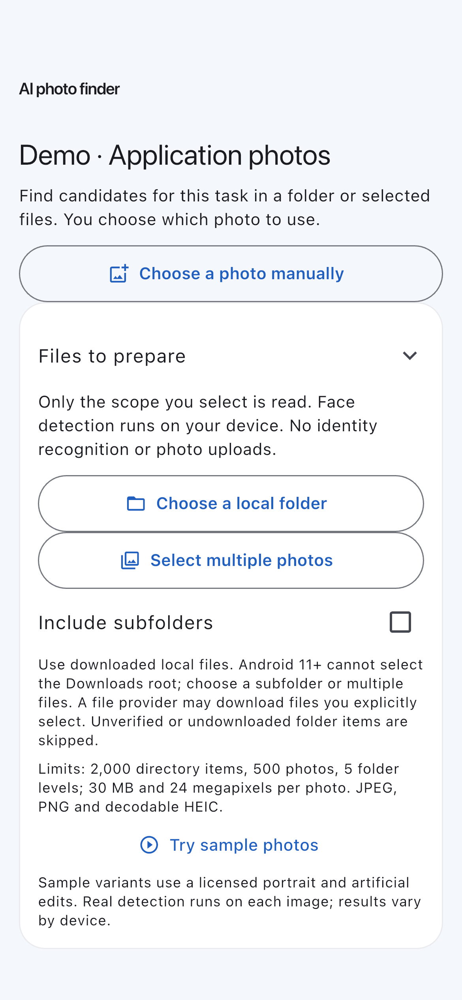 | 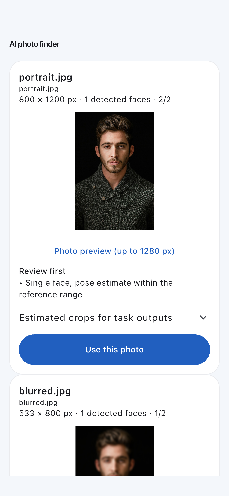 | 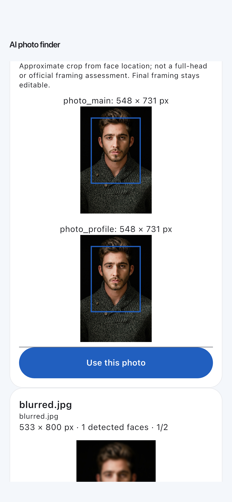 |

图像 SHA-256 见 iphone13/manifest.json。源码基线为 840c5c9 加本 PR 的找照片增量（采集时尚未提交）；测试文件为 integration_test/photo_finder_device_test.dart，采用实际系统 Vision / 随包 ML Kit。最终 Store 需按选定发布构建、完整应用路径和所需设备尺寸再次核对，不能将 Android 图标作 iPhone 图。
