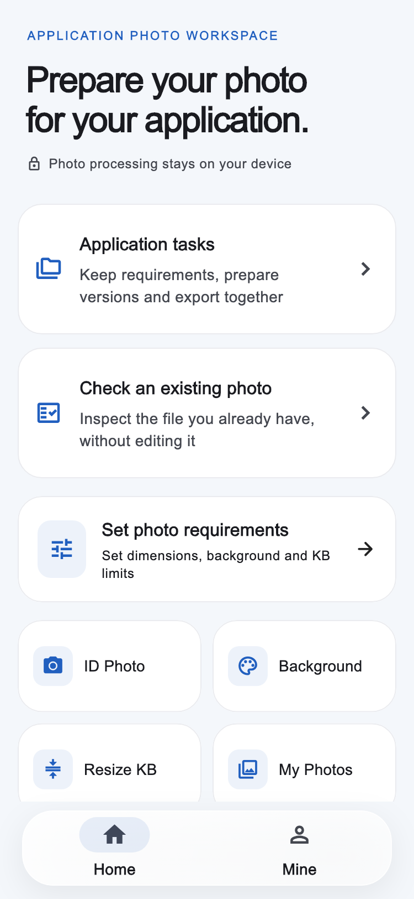
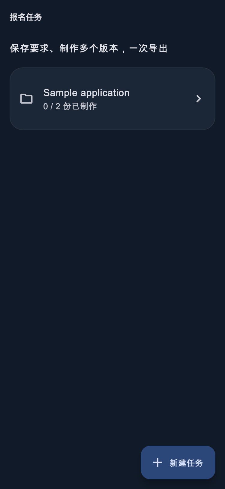
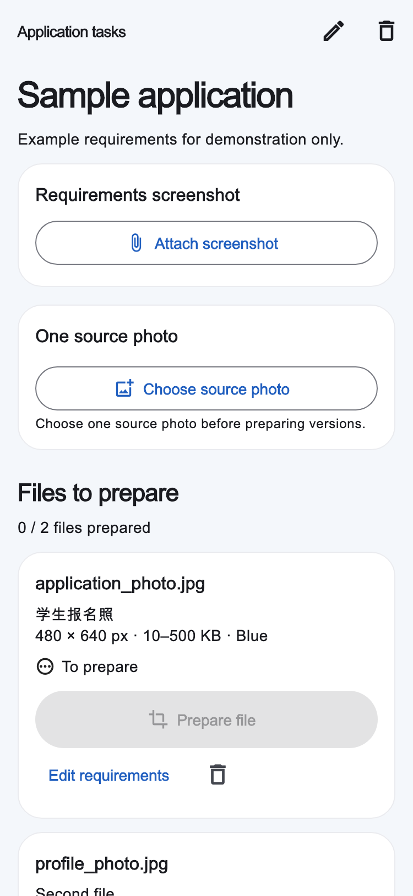
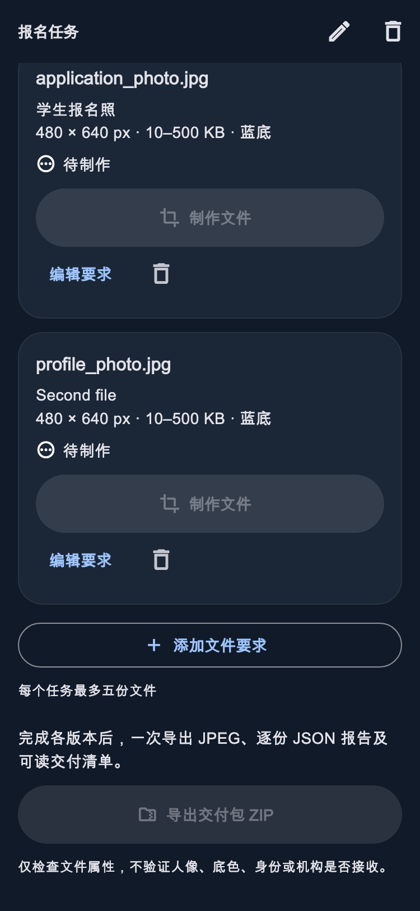
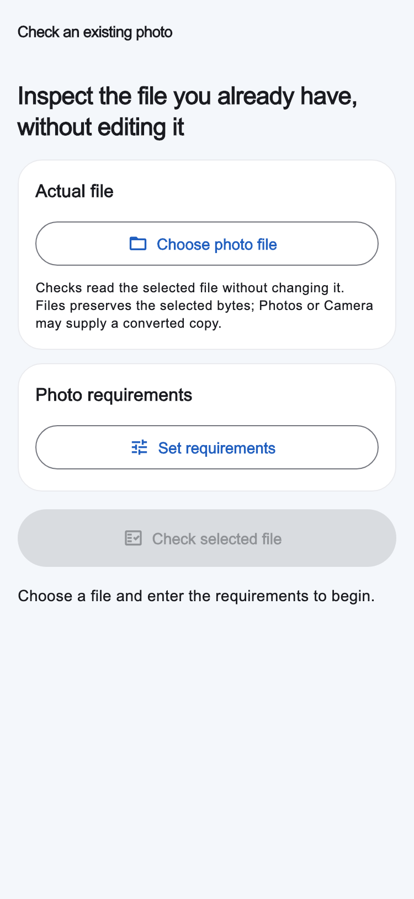

# 1.1 UI 本地渲染预览

Flutter widget 渲染，使用宿主字体；不是设备截图，不能直接上传 App Store。示例任务仅展示交互，不是机构官方模板；人像制作及系统分享仍需真机验收。

| 首页 | 任务列表 |
| --- | --- |
|  |  |

| 任务信息 | 多版本要求 |
| --- | --- |
|  |  |

| 已有文件检查入口 |
| --- |
|  |

其余文件包含中英双语、深浅主题组合。生成脚本为 `test/tools/capture_audit.dart`。
