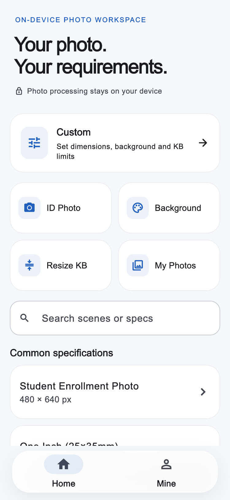
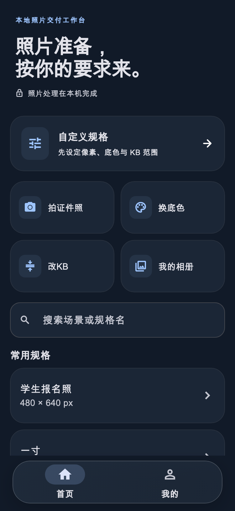
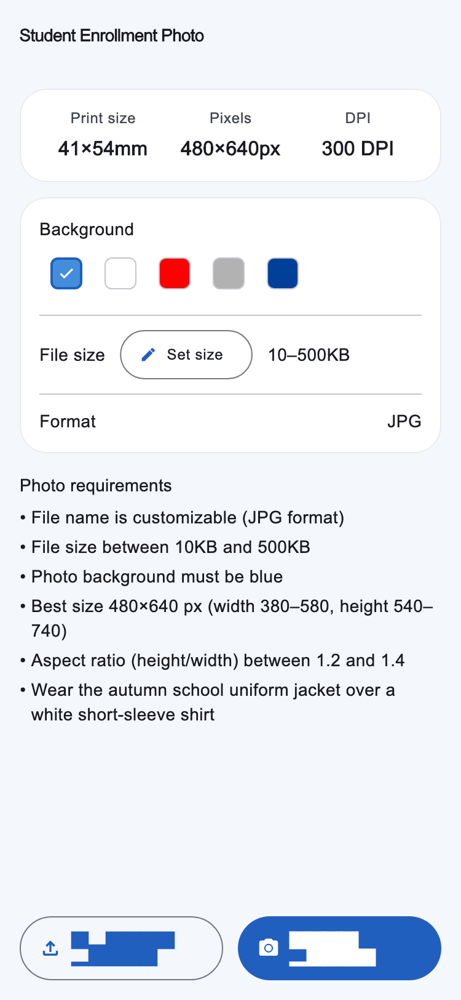
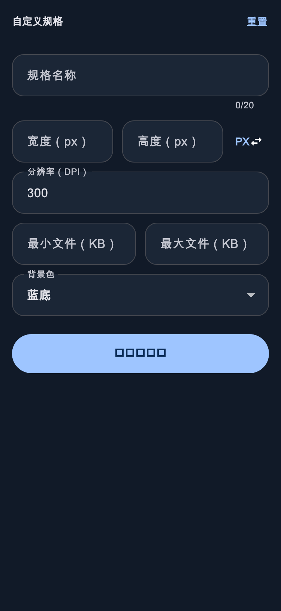
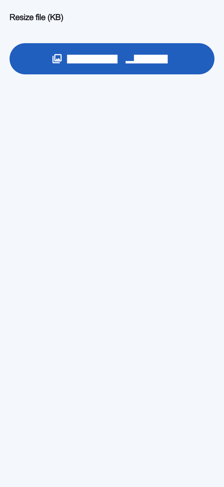
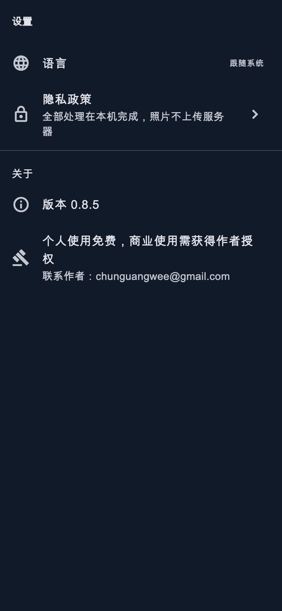

# UI 本地渲染预览

以下为 Flutter widget 测试渲染，使用宿主字体；不是手机截图，不能直接作为 App Store 截图上传。

覆盖首页、规格详情、自定义规格、KB 工具和设置，各有中英双语与深浅主题。生成脚本：`test/tools/capture_audit.dart`。

| 首页（英文浅色） | 首页（中文深色） |
| --- | --- |
|  |  |

| 规格详情 | 自定义规格 |
| --- | --- |
|  |  |

| KB 工具 | 设置 |
| --- | --- |
|  |  |
